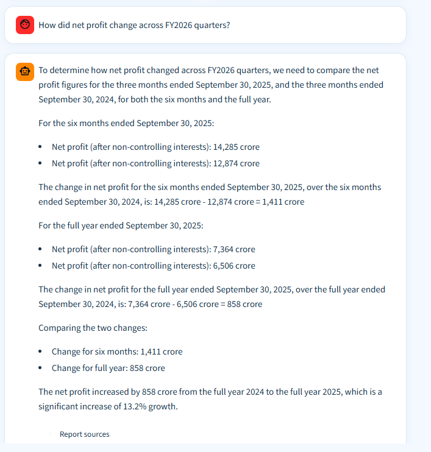

# Financial RAG

A Streamlit chat app for asking questions about financial reports. It retrieves
report excerpts, generates answers with a local Ollama model, and displays
source references.

## Screenshot



## Run locally

Install the Python dependencies:

```powershell
python -m pip install -r .\financial-retrieval\requirements.txt
```

The source reports and generated retrieval index are not included in this
public repository. Add reports under `financial-retrieval/data/raw/` and
prepare the corresponding artifacts before running the app. With Ollama
running and the default model installed:

```powershell
ollama pull qwen2.5:1.5b
python -m streamlit run .\financial-retrieval\src\chat_app.py
```

See [the project README](./financial-retrieval/README.md) for additional
question-answering options.
